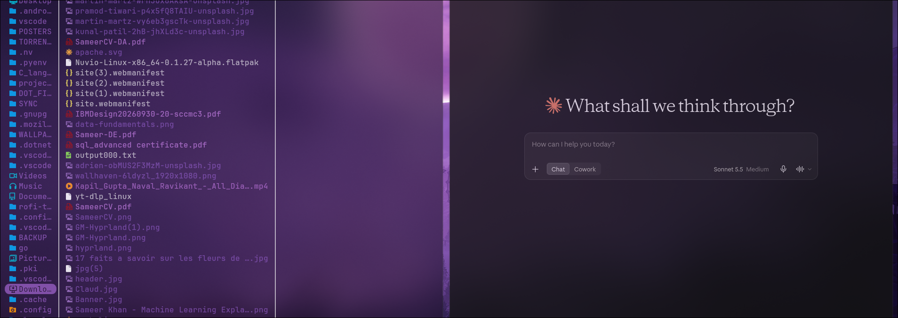

<div align="center">

# Glass Minimal Hyprland


A glass-style Hyprland desktop for Arch Linux. Blurred bar and launcher, translucent windows, and one color palette generated from the wallpaper.


</div>

## About

A complete Hyprland setup: window manager, bar, launcher, terminal, shell, file manager, editor and system monitor, all using the same colors.

- Hyprland is configured in Lua and split into small modules.
- Colors come from the wallpaper through pywal. Change the wallpaper in yazi and the bar, launcher, terminal, lock screen and Neovim follow.
- Waybar and Rofi are blurred with Hyprland layer rules.
- File pickers in GUI apps open yazi in a floating terminal window instead of a GTK dialog.
- Neovim is LazyVim with fzf-lua and a pywal colorscheme.
- One command installs the packages and copies the configs.
- No display manager, no notification daemon, no logout menu. You log in on a TTY and Hyprland starts from `.zshrc`.

**Contents:** [Preview](#preview) · [Install](#install) · [Components](#components) · [Keybindings](#keybindings) · [Rofi and clipboard](#rofi-and-clipboard) · [Yazi](#yazi) · [File picker](#file-picker) · [Waybar](#waybar) · [Kitty](#kitty) · [Neovim](#neovim) · [Lock screen and idle](#lock-screen-and-idle) · [Appearance](#appearance) · [Customization](#customization) · [Troubleshooting](#troubleshooting) · [Project layout](#project-layout)

## Preview

|             Desktop             |             Terminal             |
| :-----------------------------: | :------------------------------: |
|  |  |

|           App Launcher           |        System Monitor        |
| :------------------------------: | :--------------------------: |
|  |  |

|             File picker             |             Neovim             |
| :---------------------------------: | :----------------------------: |
|  |  |

## Install

Requires Arch Linux (or an Arch-based distro with `pacman`), `sudo`, and an internet connection.

```bash
git clone https://github.com/voidd-sam/Glass-minimal-hyprland.git && cd Glass-minimal-hyprland && bash install.sh
```

When it finishes, log out and log in on tty1. Hyprland starts by itself.

> [!WARNING]
> The installer replaces the config folders that this repo provides (`hypr`, `waybar`, `kitty`, `nvim` and so on) and your `~/.zshrc`. The old versions are saved first, see [What gets backed up](#what-gets-backed-up). Other apps in `~/.config` are not touched. Try it in a VM before running it on a machine you care about.

> [!NOTE]
> The installer does not install a GPU driver. Install the one for your hardware yourself. The NVIDIA packages the author uses are listed in `packages/extras.txt`. NVIDIA also needs extra Hyprland environment variables, see the Hyprland wiki.

### What the installer does

1. Stops if you run it as root.
2. Runs `pacman -Syu` and installs `base-devel` and `git`.
3. Builds `yay` from the AUR if it is missing.
4. Installs `packages/pacman.txt`, then `packages/aur.txt`.
5. Enables the Bluetooth service.
6. Backs up the configs it is about to replace.
7. Copies `.config/`, `starship.toml`, `.zshrc` and `WALLPAPERS/`. Creates `~/Pictures`.
8. Installs the yazi wrapper for the file picker into `/usr/share` (needs `sudo`).
9. Generates the first color palette from the first image in `~/WALLPAPERS`.
10. Sets zsh as your login shell if it is not already.
11. Rebuilds the font cache.

The package steps ask for confirmation. Nothing in the script touches your bootloader, partitions or other operating systems. Dual boot with Windows is not affected.

### What gets backed up

| What                                               | Where it goes                |
| -------------------------------------------------- | ---------------------------- |
| Folders in `~/.config` that the repo also provides | `~/.config.bak.<timestamp>/` |
| `~/.zshrc`                                         | `~/.zshrc.bak.<timestamp>`   |

To go back, move the folders from the backup into `~/.config` and the `.zshrc` backup back to `~/`.

### Optional packages

`packages/extras.txt` is not installed by the script. It holds drivers, base-system packages, apps and dev tools. Read it and install what you want:

```bash
grep -vE '^\s*(#|$)' packages/extras.txt | sudo pacman -S --needed -
```

Some lines there are hardware-specific. Remove the ones that do not match your machine first.

### Manual install

```bash
git clone https://github.com/voidd-sam/Glass-minimal-hyprland.git
cd Glass-minimal-hyprland

grep -vE '^\s*(#|$)' packages/pacman.txt | sudo pacman -S --needed -
grep -vE '^\s*(#|$)' packages/aur.txt | yay -S --needed -

cp -r .config/. ~/.config/
cp starship.toml ~/.config/
cp .zshrc ~/
cp -r WALLPAPERS ~/WALLPAPERS
mkdir -p ~/Pictures

sudo systemctl enable --now bluetooth.service
sudo install -m755 ~/.config/xdg-desktop-portal-termfilechooser/yazi-wrapper.sh /usr/share/xdg-desktop-portal-termfilechooser/yazi-wrapper.sh

img=~/WALLPAPERS/<image>
magick "$img" -resize 704x760^ -gravity center -extent 704x760 ~/.cache/rofi-wall.png
wal -n -i "$img" --contrast 1
ln -sf ~/.cache/wal/colors-waybar.css ~/.config/waybar/colors.css

chsh -s "$(command -v zsh)"
fc-cache -f
```

### Login and logout

There is no display manager. Log in on tty1 and `.zshrc` runs `exec start-hyprland`. Logging in on any other TTY gives a normal shell.

| Action          | How                 |
| --------------- | ------------------- |
| Log out         | `Super + Shift + M` |
| Lock the screen | `Super + L`         |

After logging out you are back at the TTY login prompt. If Hyprland fails to start, press `Ctrl + Alt + F2` for a text login and fix the config from there.

### Tested with

| Package  | Version |
| -------- | ------- |
| Hyprland | 0.57.2  |
| Waybar   | 0.16.0  |
| Rofi     | 2.1.1   |
| Kitty    | 0.50.0  |
| Neovim   | 0.12.6  |
| yazi     | 26.9.1  |

The Hyprland config uses the Lua API (`hl.bind`, `hl.config`), so it needs a Hyprland version that supports Lua configs.

## Components

| Component          | Tool                                               |
| ------------------ | -------------------------------------------------- |
| Window manager     | Hyprland                                           |
| Bar                | Waybar                                             |
| Launcher           | Rofi, Papirus-Dark icons                           |
| Terminal           | Kitty                                              |
| Shell              | zsh, zsh-autosuggestions, zsh-syntax-highlighting  |
| Prompt             | Starship (Nerd Font Symbols preset)                |
| File manager       | yazi                                               |
| File picker        | xdg-desktop-portal-termfilechooser (opens yazi)    |
| Screen sharing     | xdg-desktop-portal-hyprland                        |
| Editor             | Neovim with LazyVim                                |
| Wallpaper          | awww                                               |
| Color palette      | pywal16 (`wal`)                                    |
| Clipboard history  | cliphist, wl-clipboard                             |
| Screenshots        | grim, slurp                                        |
| Lock / idle        | hyprlock, hypridle                                 |
| Night light        | hyprsunset                                         |
| System info        | fastfetch                                          |
| System monitor     | btop                                               |
| Audio              | PipeWire, WirePlumber, pavucontrol, playerctl      |
| Network, Bluetooth | NetworkManager (nmtui, nm-applet), bluez (bluetui) |
| Brightness         | brightnessctl                                      |
| Font               | JetBrainsMono Nerd Font                            |

The exact package lists are in `packages/pacman.txt` and `packages/aur.txt`.

AUR packages: `python-pywal16`, `xdg-desktop-portal-termfilechooser-hunkyburrito-git`, `librewolf-bin`, `visual-studio-code-bin`, `ttf-inter-variable`, `yay`.

## Keybindings

`Super` is the main modifier. Source: `hypr/modules/keybindings.lua`.

### Windows and apps

| Keys                  | Action                                           |
| --------------------- | ------------------------------------------------ |
| `Super + Q`           | Terminal                                         |
| `Super + C`           | Close window                                     |
| `Super + Shift + M`   | Exit Hyprland (uses `hyprshutdown` if installed) |
| `Super + N`           | Neovim in Kitty                                  |
| `Super + E`           | File manager                                     |
| `Super + F`           | Toggle floating                                  |
| `Super + P`           | Toggle pseudo-tiling                             |
| `Super + J`           | Toggle split direction (dwindle)                 |
| `Super + Space`       | App launcher (press again to close)              |
| `Super + V`           | Clipboard history                                |
| `Super + L`           | Lock screen                                      |
| `Super + B`           | Bluetooth manager (bluetui)                      |
| `Super + W`           | WiFi manager (nmtui)                             |
| `Super + F10`         | Toggle night light (4000K)                       |
| `Super + Arrow keys`  | Move focus                                       |
| `Super + Left mouse`  | Drag window                                      |
| `Super + Right mouse` | Resize window                                    |

### Workspaces

| Keys                     | Action                                     |
| ------------------------ | ------------------------------------------ |
| `Super + 1-9, 0`         | Go to workspace 1-10 (`0` is workspace 10) |
| `Super + Shift + 1-9, 0` | Move window to workspace 1-10              |
| `Super + Escape`         | Next existing workspace                    |
| `Super + T`              | Go to the first empty workspace            |
| `Super + Scroll`         | Previous / next existing workspace         |

### Screenshots

| Keys               | Action                                            |
| ------------------ | ------------------------------------------------- |
| `Print`            | Select an area, save it, copy it to the clipboard |
| `Ctrl + Shift + S` | Same as `Print`                                   |

Files are saved to `~/Pictures/screenshot_<date>_<time>.png`. The `~/Pictures` folder must exist. The installer creates it.

### Media keys

Volume (5% steps, capped at 100%), mic mute, brightness and playback keys (`XF86*`) are bound. They also work on the lock screen.

### Window rules

Popup windows float and open at a fixed size:

| Window class      | Opened by                          | Size      |
| ----------------- | ---------------------------------- | --------- |
| `bluetui`         | `Super + B`, Waybar Bluetooth icon | 440 x 540 |
| `nmtui`           | `Super + W`, Waybar network icon   | 500 x 600 |
| `termfilechooser` | File picker                        | 900 x 600 |

Maximize requests from apps are ignored.

### Autostart

Started with Hyprland (`hypr/modules/autostart.lua`): `nm-applet`, `waybar`, `awww-daemon`, `hypridle`, and two `wl-paste --watch cliphist store` processes (text and images) that record clipboard history.

## Rofi and clipboard

| Keys            | Action                                                                         |
| --------------- | ------------------------------------------------------------------------------ |
| `Super + Space` | App launcher (`drun` with icons). Pressing it again closes Rofi.               |
| `Super + V`     | Clipboard history in Rofi. The selected entry is copied back to the clipboard. |

Inside Rofi:

| Input             | Action                                              |
| ----------------- | --------------------------------------------------- |
| Type              | Fuzzy search on name, exec, categories and keywords |
| Enter, left click | Launch                                              |
| Right click       | Select entry                                        |

The launcher is 750x420 with a 25px radius and a translucent background. The left card shows the current wallpaper from `~/.cache/rofi-wall.png`. That file is generated by yazi (and by the installer), not edited by hand. If the card is empty, press `g` `b` on a wallpaper in yazi.

Clipboard history only records what is copied after login. It is stored by `cliphist`.

## Yazi

Yazi is the file manager and the wallpaper picker. Config: `yazi/yazi.toml` and `yazi/keymap.toml`.

| Keys    | Action                                                        |
| ------- | ------------------------------------------------------------- |
| `o`     | Open with a picker                                            |
| `g` `b` | Set the hovered image as wallpaper and regenerate the palette |
| `g` `w` | Go to `~/WALLPAPERS`                                          |
| `g` `p` | Go to `~/projects`                                            |
| `g` `D` | Go to `~/Documents`                                           |

`g` `b` runs three steps on the file under the cursor:

1. `magick` crops the center of the image to 704x760 and writes `~/.cache/rofi-wall.png`. The old file is overwritten.
2. `awww img` sets the wallpaper.
3. `wal -i --contrast 1` generates the palette.

Other settings:

- Hidden files are shown.
- Sorted by creation time, newest first.
- Text and JSON files open in Neovim. Nano, VS Code and GNOME Text Editor are in the picker.

> [!NOTE]
> Waybar reads the palette when it starts. After changing the wallpaper, reload it with `pkill -SIGUSR2 waybar`.

## File picker

When an app asks for a file (upload, save, attach), yazi opens in a floating Kitty window instead of the GTK dialog. This is done by `xdg-desktop-portal-termfilechooser`.

Four files make it work, all in the repo:

| File                                                 | Purpose                                                      |
| ---------------------------------------------------- | ------------------------------------------------------------ |
| `xdg-desktop-portal/portals.conf`                    | Sends file chooser requests to termfilechooser               |
| `xdg-desktop-portal-termfilechooser/config`          | Tells termfilechooser to run the wrapper                     |
| `xdg-desktop-portal-termfilechooser/yazi-wrapper.sh` | Starts yazi in Kitty with the window class `termfilechooser` |
| `hypr/hyprland.lua` (window rule)                    | Floats windows of class `termfilechooser`                    |

`portals.conf`:

```ini
[preferred]
org.freedesktop.impl.portal.FileChooser=termfilechooser
```

`config`:

```ini
[filechooser]
cmd=yazi-wrapper.sh
default_dir=$HOME
open_mode = suggested
save_mode = suggested
```

The wrapper is the stock one from the package with one change: Kitty is started with `--class` instead of `--title`, so the window rule can match it. The installer copies it to `/usr/share/xdg-desktop-portal-termfilechooser/`, where the portal looks for it.

A package update can put the stock wrapper back. If the picker opens tiled again, run:

```bash
sudo install -m755 ~/.config/xdg-desktop-portal-termfilechooser/yazi-wrapper.sh /usr/share/xdg-desktop-portal-termfilechooser/yazi-wrapper.sh
systemctl --user restart xdg-desktop-portal xdg-desktop-portal-termfilechooser
```

In the picker, move to a file and press `Enter`. To pick several, select them with `Space` first. Press `q` to cancel.

> [!NOTE]
> Firefox-based browsers (Firefox, LibreWolf) ignore the portal by default. Set `widget.use-xdg-desktop-portal.file-picker` to `1` in `about:config`. Some GTK apps also need `GTK_USE_PORTAL=1`.

## Waybar

Config: `waybar/config.jsonc` and `waybar/style.css`.

| Section | Modules                                                             |
| ------- | ------------------------------------------------------------------- |
| Left    | Arch icon, workspaces, active window class                          |
| Center  | Clock (`HH:MM \| day month`), month calendar in the tooltip         |
| Right   | Volume, network, Bluetooth, CPU, memory, temperature, battery, tray |

Clicking a module:

| Module    | Action                                        |
| --------- | --------------------------------------------- |
| Volume    | Opens pavucontrol                             |
| Network   | Opens nmtui (floating, same as `Super + W`)   |
| Bluetooth | Opens bluetui (floating, same as `Super + B`) |

Temperature turns red and blinks at 85 degrees. Battery changes color at 30% and 15%.

### Colors

`style.css` imports `colors.css` from its own folder. The installer makes that file a symlink to `~/.cache/wal/colors-waybar.css`, which pywal rewrites on every `wal` run. The symlink is created on each machine, so it is not stored in the repo.

### Blur

The bar window is fully transparent. Only the three groups (left, center, right) are drawn, as rounded pills tinted with pywal `color0` at 60% alpha. Hyprland blurs what is behind them through this rule in `looks.lua`:

```lua
hl.layer_rule({
	name = "waybar-blur",
	match = { namespace = "waybar" },
	blur = true,
	ignore_alpha = 0.01,
})
```

`ignore_alpha = 0.01` lets Hyprland blur even the nearly transparent parts. Without it the bar showed no blur. Rofi uses the same rule with the namespace `rofi`.

## Kitty

Config: `kitty/kitty.conf`.

- Colors come from `~/.cache/wal/colors-kitty.conf`, so the terminal follows the wallpaper.
- Font: JetBrainsMono Nerd Font, size 12.
- Background opacity 0.6. Inactive text is dimmed with `inactive_text_alpha 0.7`.
- Cursor trail is on.

| Keys       | Action                                                                                                                           |
| ---------- | -------------------------------------------------------------------------------------------------------------------------------- |
| `Ctrl + F` | Fuzzy file finder with a `bat` preview in a new tab. The chosen file opens in Neovim. Inside it, `Ctrl + /` toggles the preview. |

> [!NOTE]
> Kitty's own opacity (0.6) multiplies with Hyprland's window opacity (0.85 active, 0.8 inactive). The terminal ends up more transparent than other apps. Change `background_opacity` in `kitty.conf` or `active_opacity` in `looks.lua` to balance them.

## Neovim

LazyVim with a few additions. Config is in `nvim/`.

- **Colorscheme:** `pywal16.nvim`, so it follows the wallpaper. Syntax groups are overridden with the Catppuccin Mocha palette in `init.lua`.
- **Picker:** `fzf-lua` with the `telescope` profile, `fd` for files, `ripgrep` for search, `bat` for previews. Hidden files are included, `.git` and `node_modules` are excluded.
- **Mouse:** enabled.

Leader is `Space`. Everything else is the LazyVim default, and pressing `Space` shows the available keys.

| Keys           | Action                                      |
| -------------- | ------------------------------------------- |
| `<leader> a`   | Copy the whole file to the system clipboard |
| `<leader> f f` | Find files                                  |
| `<leader> f g` | Find by grep                                |
| `<leader> f b` | Find buffers                                |
| `<leader> f r` | Recent files                                |
| `<leader> f .` | Resume last picker                          |
| `<leader> f w` | Grep word under cursor                      |
| `<leader> f s` | LSP document symbols                        |
| `<leader> g c` | Git commits                                 |
| `<leader> g s` | Git status                                  |
| `Ctrl + t`     | New tab                                     |

Plugins install on the first launch. The colorscheme needs `wal` to have run once. The installer does that.

## Shell

Config: `.zshrc`, `starship.toml`.

- Starts Hyprland on tty1.
- Runs `fastfetch` at the start of every shell.
- Autosuggestions, syntax highlighting, `zoxide` (`z`) and `fzf` key bindings (`Ctrl + R`, `Ctrl + T`). `fzf` uses `fd` as its file source.
- History is shared between shells and does not store duplicates.

### Fastfetch

Config: `fastfetch/config.jsonc`. It draws a boxed list next to an image logo from `~/.config/fastfetch/pngs/`. The logo uses the Kitty graphics protocol, so it only shows inside Kitty.

Fields: user, host, OS age (from the first line of `/var/log/pacman.log`), uptime, kernel, packages, desktop, WM, terminal, shell, CPU, disk, memory, battery, power adapter, color row.

## Lock screen and idle

| File                 | What it does                                                                                                                 |
| -------------------- | ---------------------------------------------------------------------------------------------------------------------------- |
| `hypr/hyprlock.conf` | Lock screen: blurred wallpaper, round profile picture, username, password field, big clock with weekday, day, month and year |
| `hypr/hypridle.conf` | Locks after 5 minutes without input. Also locks before sleep.                                                                |

Hypridle only locks. It does not turn the screen off or suspend the machine.

To change the lock screen wallpaper or profile picture, edit the `path =` lines in `hypr/hyprlock.conf`.

Lock screen colors come from pywal. Pywal fills in a template, `wal/templates/colors-hyprlock.conf`, into `~/.cache/wal/colors-hyprlock.conf` on every `wal` run, and `hyprlock.conf` loads it with `source`:

```
$background = rgb({background.strip})
$text = rgb({foreground.strip})
$textAlpha = {foreground.strip}
$red = rgb({color1.strip})
$green = rgb({color2.strip})
$yellow = rgb({color3.strip})
$blue = rgb({color4.strip})
```

## Appearance

Values from `looks.lua` and `animations.lua`.

| Setting                     | Value                           |
| --------------------------- | ------------------------------- |
| Gaps (inner / outer)        | 8 / 12                          |
| Window border               | none (`border_size = 0`)        |
| Corner rounding             | 18, rounding power 5            |
| Opacity (active / inactive) | 0.85 / 0.8                      |
| Blur                        | size 9, 3 passes, vibrancy 0.17 |
| Shadow                      | range 4, render power 3         |
| Layout                      | dwindle                         |
| Font                        | JetBrainsMono Nerd Font         |

Animations:

| Target                             | Motion                             |
| ---------------------------------- | ---------------------------------- |
| Windows                            | Spring (`bouncy`), pop-in from 60% |
| Window close                       | Ease-in-back, pop-out to 70%       |
| Layers (Rofi, bars, notifications) | Overshoot pop-in from 80%          |
| Workspaces                         | Slide with a soft bounce           |
| Fades                              | Exponential ease-out               |

Curves and springs (`overshoot`, `softBounce`, `silk`, `bouncy`, `jelly`, `snappy`, `smooth`) are defined at the top of `animations.lua`. Spring damping ratio is `dampening / (2 * sqrt(mass * stiffness))`. Below 1 it bounces.

## Customization

| What                               | Where                                      |
| ---------------------------------- | ------------------------------------------ |
| Keybindings                        | `hypr/modules/keybindings.lua`             |
| Blur, gaps, opacity                | `hypr/modules/looks.lua`                   |
| Animations                         | `hypr/modules/animations.lua`              |
| Autostart                          | `hypr/modules/autostart.lua`               |
| Monitors                           | `hypr/modules/monitor.lua`                 |
| Input                              | `hypr/modules/input.lua`                   |
| Terminal and file manager commands | `hypr/modules/environment_variables.lua`   |
| Window rules                       | `hypr/hyprland.lua`                        |
| Lock screen, idle                  | `hypr/hyprlock.conf`, `hypr/hypridle.conf` |
| Bar                                | `waybar/config.jsonc`, `waybar/style.css`  |
| Launcher                           | `rofi/config.rasi`                         |
| Terminal                           | `kitty/kitty.conf`                         |
| Yazi                               | `yazi/yazi.toml`, `yazi/keymap.toml`       |
| Neovim keys and plugins            | `nvim/lua/config/`, `nvim/lua/plugins/`    |
| Prompt                             | `starship.toml`                            |
| Packages                           | `packages/pacman.txt`, `packages/aur.txt`  |

To change the wallpaper and every color with it: open yazi, press `g` `w`, hover an image, press `g` `b`.

## Troubleshooting

| Problem                               | Fix                                                                                                         |
| ------------------------------------- | ----------------------------------------------------------------------------------------------------------- |
| Hyprland does not start               | `Ctrl + Alt + F2`, log in, check `~/.config/hypr/`. Config errors are shown on screen when Hyprland starts. |
| Launcher card is empty                | Press `g` `b` on an image in yazi                                                                           |
| Waybar, Rofi or Neovim have no colors | Run `wal -i <image> --contrast 1` once                                                                      |
| Colors did not change on the bar      | `pkill -SIGUSR2 waybar`                                                                                     |
| Icons show as empty boxes             | `fc-cache -f` and check that JetBrainsMono Nerd Font is installed                                           |
| Clipboard history is empty            | `pgrep -a wl-paste`. Two processes should be running. Log out and in again.                                 |
| Apps show the GTK file dialog         | Check `portals.conf`, then restart the portals (see [File picker](#file-picker))                            |
| File picker opens tiled               | Reinstall the wrapper (see [File picker](#file-picker))                                                     |
| No Bluetooth adapter in bluetui       | `sudo systemctl enable --now bluetooth.service`                                                             |
| Screen sharing does not work          | Check `xdg-desktop-portal-hyprland` is installed, then log out and in again                                 |
| Screenshot does not save              | Make sure `~/Pictures` exists                                                                               |

## Project layout

```text
Glass-minimal-hyprland/
├── .config/
│   ├── hypr/
│   │   ├── hyprland.lua           # loads modules, window rules
│   │   ├── hyprlock.conf          # lock screen
│   │   ├── hypridle.conf          # idle lock
│   │   ├── hyprlock-profiles/     # profile picture for the lock screen
│   │   └── modules/               # monitor, autostart, environment_variables,
│   │                              # input, keybindings, looks, animations
│   ├── waybar/                    # config.jsonc, style.css
│   ├── rofi/                      # config.rasi
│   ├── kitty/                     # kitty.conf
│   ├── yazi/                      # yazi.toml, keymap.toml
│   ├── nvim/                      # init.lua, lua/config/, lua/plugins/
│   ├── fastfetch/                 # config.jsonc, pngs/
│   ├── btop/                      # theme
│   ├── wal/
│   │   └── templates/             # colors-hyprlock.conf
│   ├── xdg-desktop-portal/
│   │   └── portals.conf
│   └── xdg-desktop-portal-termfilechooser/
│       ├── config
│       └── yazi-wrapper.sh
├── packages/
│   ├── pacman.txt                 # desktop packages (installed)
│   ├── aur.txt                    # AUR packages (installed)
│   └── extras.txt                 # drivers, apps, base system (not installed)
├── WALLPAPERS/                    # copied to ~/WALLPAPERS
├── assets/                        # logo and screenshots
├── .zshrc
├── starship.toml
├── install.sh
├── LICENSE
└── README.md
```
