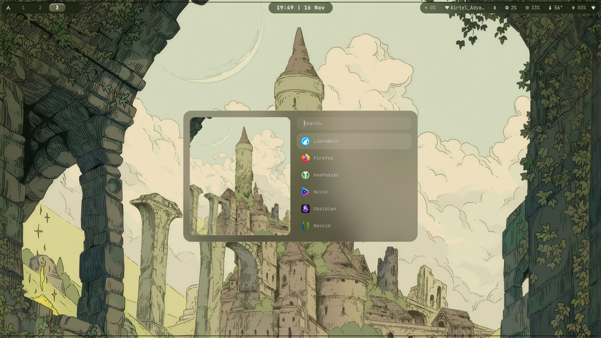
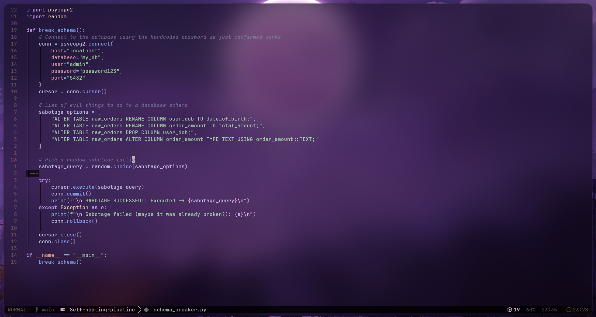

<div align="center">

# lace-hyprland




A glass style Hyprland desktop. Blurred bar and launcher, translucent windows, one for al, color palette generated from the wallpaper.

</div>

## About

- Hyprland configured in Lua, split into small modules.
- Colors come from the wallpaper through pywal. Change the wallpaper in yazi and everything follows.
- File pickers in GUI apps open yazi in a floating terminal instead of a GTK dialog.
- No display manager, notification daemon or logout menu. Log in on tty1 and Hyprland starts from `.zshrc`.

## Preview

|             Desktop             |             Terminal             |
| :-----------------------------: | :------------------------------: |
|  |  |

|           App Launcher           |        System Monitor        |
| :------------------------------: | :--------------------------: |
|  |  |

|             File picker             |             Neovim             |
| :---------------------------------: | :----------------------------: |
|  |  |

## Install

Arch Linux with `sudo`

```bash
git clone https://github.com/voidd-sam/lace-hyprland.git && cd lace-hyprland && bash install.sh
```

Then log out and log in on tty1.

> [!WARNING]
> The installer replaces the config folders this repo provides (`hypr`, `waybar`, `kitty`, `nvim`, ...) and `~/.zshrc`. Old copies go to `~/.config.bak.<timestamp>` and `~/.zshrc.bak.<timestamp>`. Other apps in `~/.config` are untouched. Try it in a VM first.

> [!NOTE]
> No GPU driver is installed. `packages/extras.txt` lists optional drivers, apps and base packages. The installer ignores it.

If Hyprland fails to start, press `Ctrl + Alt + F2` for a text login.

Tested with Hyprland 0.57.2. The config uses the Lua API, so it needs a Hyprland version that supports it.

## Components

| Component          | Tool                                          |
| ------------------ | --------------------------------------------- |
| Window manager     | Hyprland                                      |
| Bar / launcher     | Waybar / Rofi                                 |
| Terminal / shell   | Kitty / zsh with Starship                     |
| File manager       | yazi, with termfilechooser as the file picker |
| Editor             | Neovim (LazyVim)                              |
| Wallpaper / colors | awww / pywal16                                |
| Clipboard          | cliphist, wl-clipboard                        |
| Lock / idle        | hyprlock, hypridle                            |
| Other              | grim, slurp, hyprsunset, fastfetch, btop      |

Package lists: `packages/pacman.txt`, `packages/aur.txt`.

## Keybindings

`Super` is the main modifier. Full list: `hypr/modules/keybindings.lua`.

| Keys                      | Action                                           |
| ------------------------- | ------------------------------------------------ |
| `Super + Q`               | Terminal                                         |
| `Super + C`               | Close window                                     |
| `Super + Shift + M`       | Log out                                          |
| `Super + L`               | Lock screen                                      |
| `Super + Space`           | App launcher                                     |
| `Super + V`               | Clipboard history                                |
| `Super + E`               | File manager                                     |
| `Super + N`               | Neovim                                           |
| `Super + F`               | Toggle floating                                  |
| `Super + J`               | Toggle split direction                           |
| `Super + B` / `Super + W` | Bluetooth / WiFi manager                         |
| `Super + F10`             | Night light                                      |
| `Super + 1-9, 0`          | Go to workspace (`0` is 10)                      |
| `Super + Shift + 1-9, 0`  | Move window to workspace                         |
| `Super + T`               | First empty workspace                            |
| `Super + Arrows`          | Move focus                                       |
| `Super + Mouse`           | Left drag moves, right drag resizes              |
| `Print`, `Ctrl+Shift+S`   | Screenshot an area to `~/Pictures` and clipboard |

## Yazi

| Keys    | Action                                               |
| ------- | ---------------------------------------------------- |
| `g` `b` | Set hovered image as wallpaper and regenerate colors |
| `g` `w` | Go to `~/WALLPAPERS`                                 |
| `o`     | Open with a picker                                   |

`g` `b` also writes `~/.cache/rofi-wall.png`, the image on the launcher's left card. Reload the bar afterwards with `pkill -SIGUSR2 waybar`.

## File picker

`xdg-desktop-portal-termfilechooser` runs yazi in Kitty whenever an app asks for a file.

- `xdg-desktop-portal/portals.conf` and `xdg-desktop-portal-termfilechooser/config` route and configure it.
- `yazi-wrapper.sh` is the stock wrapper with Kitty's `--title` changed to `--class`, so the window rule in `hyprland.lua` can float it. The installer copies it to `/usr/share/xdg-desktop-portal-termfilechooser/`. If a package update restores the stock one, run `sudo install -m755 ~/.config/xdg-desktop-portal-termfilechooser/yazi-wrapper.sh /usr/share/xdg-desktop-portal-termfilechooser/`.
- Firefox-based browsers need `widget.use-xdg-desktop-portal.file-picker` set to `1` in `about:config`.

In the picker, `Enter` selects, `Space` marks several files, `q` cancels.

## Waybar

Colors come from `~/.cache/wal/colors-waybar.css`, linked as `waybar/colors.css` by the installer. Clicking volume, network or Bluetooth opens pavucontrol, nmtui or bluetui.

The bar window is transparent and only the three pills are tinted. This rule makes Hyprland blur behind them (without `ignore_alpha` the bar showed no blur):

```lua
hl.layer_rule({
	name = "waybar-blur",
	match = { namespace = "waybar" },
	blur = true,
	ignore_alpha = 0.01,
})
```

## Kitty

Colors from pywal. `Ctrl + F` opens a fuzzy file finder in a new tab and edits the result in Neovim.

> [!NOTE]
> Kitty's `background_opacity` (0.6) multiplies with Hyprland's window opacity (0.85), so the terminal is more transparent than other apps.

## Neovim

Leader is `Space`. The rest is LazyVim defaults. Colorscheme is `pywal16.nvim`, picker is `fzf-lua`.

| Keys                 | Action                       |
| -------------------- | ---------------------------- |
| `<leader> a`         | Copy whole file to clipboard |
| `<leader> f f`       | Files                        |
| `<leader> f g`       | Grep                         |
| `<leader> f b`       | Buffers                      |
| `<leader> f r`       | Recent files                 |
| `<leader> f w`       | Grep word under cursor       |
| `<leader> f s`       | LSP symbols                  |
| `<leader> g c / g s` | Git commits / status         |
| `Ctrl + t`           | New tab                      |

Needs `fd`, `ripgrep` and `bat`. All are in `pacman.txt`.

## Lock screen

Hyprlock colors come from pywal through the template `wal/templates/colors-hyprlock.conf`. Change the wallpaper and profile picture paths in `hypr/hyprlock.conf`. Hypridle locks after 5 minutes and before sleep. It does not turn the screen off or suspend.

## Troubleshooting

| Problem                              | Fix                                                 |
| ------------------------------------ | --------------------------------------------------- |
| No colors in Waybar, Rofi or Neovim  | `wal -i <image> --contrast 1`                       |
| Launcher card is empty               | Press `g` `b` on an image in yazi                   |
| Clipboard history is empty           | `pgrep -a wl-paste` should show two processes       |
| File picker is a GTK dialog or tiled | Check `portals.conf`, reinstall the wrapper (above) |
| No Bluetooth adapter                 | `sudo systemctl enable --now bluetooth.service`     |
| Icons show as boxes                  | `fc-cache -f`                                       |

## Layout

```text
lace-hyprland/
├── .config/
│   ├── hypr/             # hyprland.lua, modules/, hyprlock.conf, hypridle.conf
│   ├── waybar/           # config.jsonc, style.css
│   ├── rofi/             # config.rasi
│   ├── kitty/            # kitty.conf
│   ├── yazi/             # yazi.toml, keymap.toml
│   ├── nvim/             # LazyVim config
│   ├── fastfetch/
│   ├── btop/
│   ├── wal/templates/    # colors-hyprlock.conf
│   ├── xdg-desktop-portal/
│   └── xdg-desktop-portal-termfilechooser/
├── packages/             # pacman.txt, aur.txt, extras.txt
├── WALLPAPERS/           # copied to ~/WALLPAPERS
├── assets/               # logo and screenshots
├── .zshrc
├── starship.toml
├── install.sh
├── LICENSE
└── README.md
```
